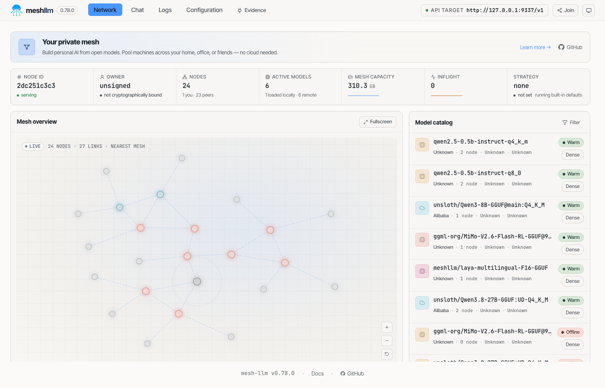
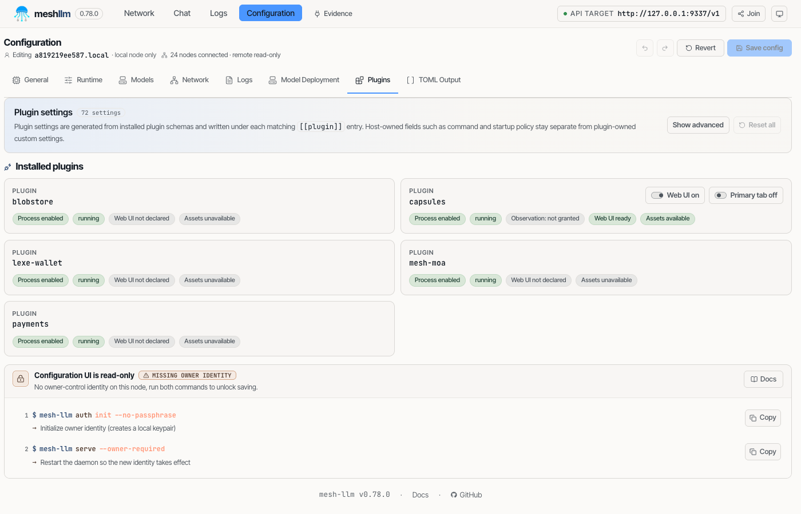
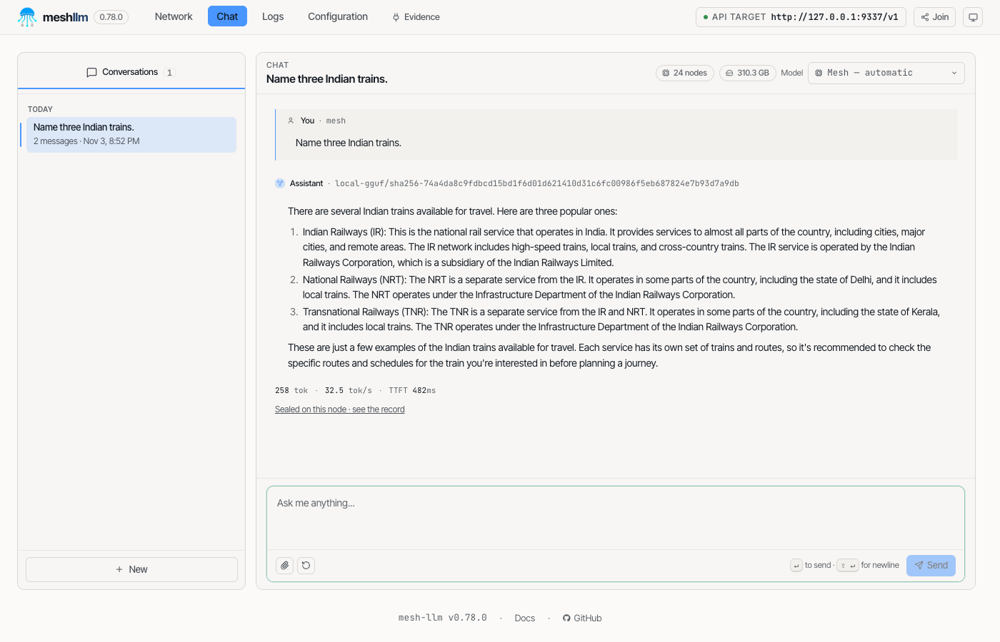
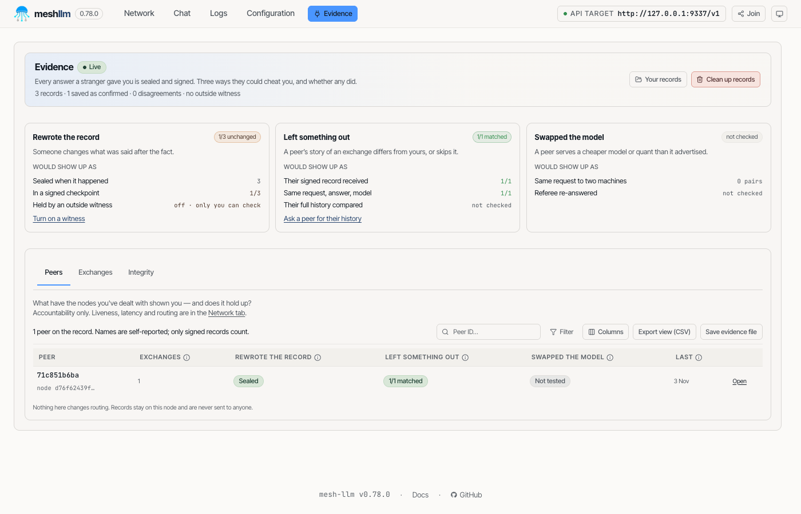
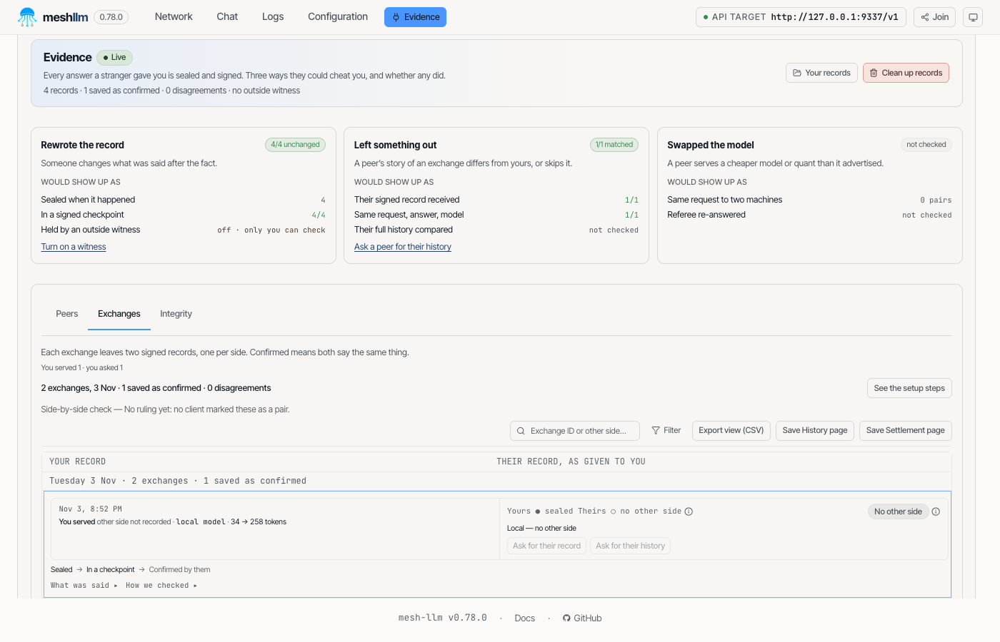
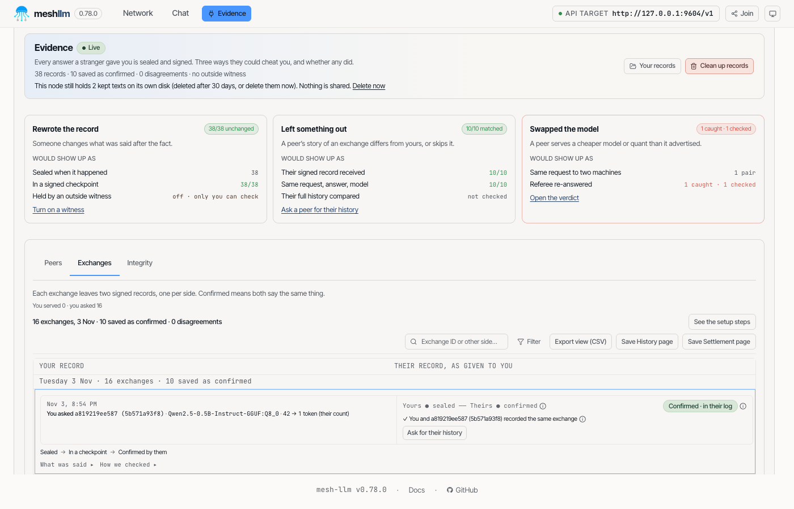
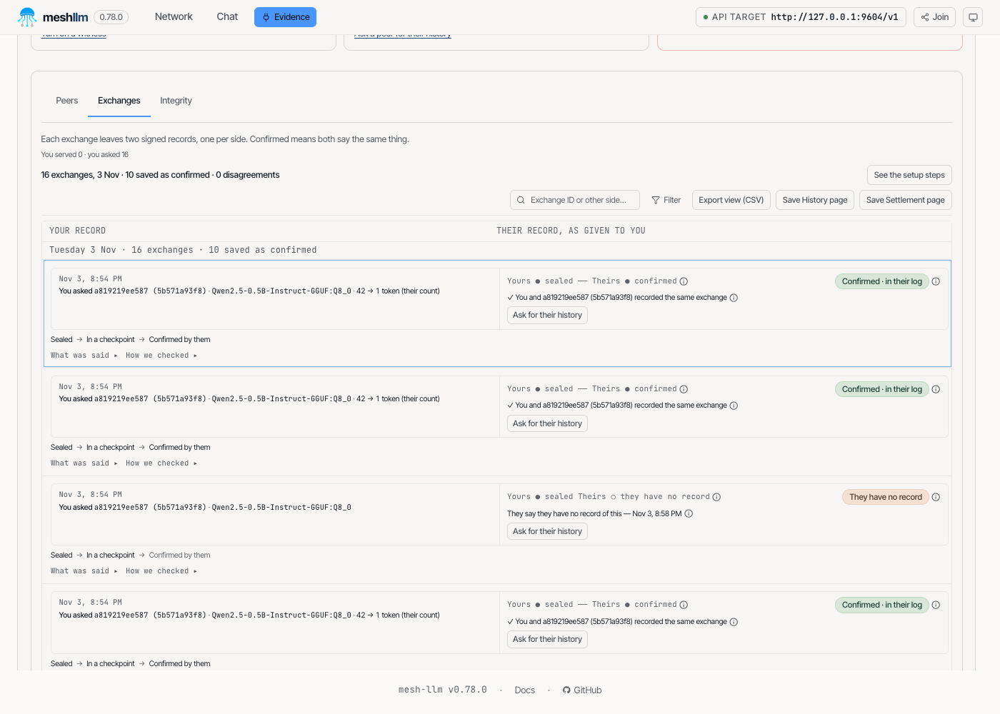
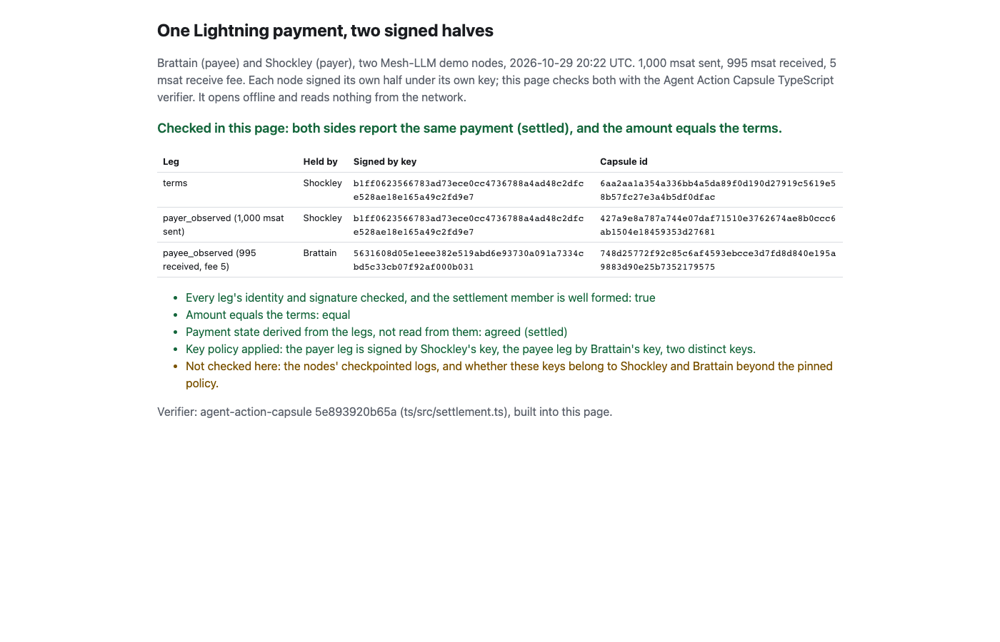

# Mesh-LLM evidence workshop: walk-through

This walk-through runs the workshop from the Docker image, step by step, with what you should see at
each step. It replaces the older "Mesh-LLM evidence demo: join the mesh" Google doc, which installed
mesh-llm natively. The [README](README.md) remains the reference for every `devcon8` command.

**What you are running.** The image's `latest` tag, a **pre-release lab build** of
[mesh-llm](https://github.com/Mesh-LLM/mesh-llm) ahead of the next release (0.79). It prints
`mesh-llm 0.78.0`; the latest official release is 0.78.1. It is lab commit `1aba71d` with
the [capsules](https://github.com/Mesh-LLM/capsules-plugin) evidence plugin v0.1.14 and the lexe-wallet
plugin. `devcon8 doctor` prints the exact build. The screenshots below were taken on an Apple-silicon
laptop on 2026-11-03 with image revision `80ed6c66`.

You will:

1. get the image onto your laptop and start it;
2. join the real demo mesh as a **serving** node, chat, and read your Evidence page;
3. run S08 on a private four-node mesh inside your container, where a node lies about its model and
   then hides exchanges, and watch both lies get caught;
4. call the reports yourself: the receipt, the settlement receipt and the history.

## Before you start

- Docker Desktop (macOS, Windows) or Docker Engine (Linux), with **at least 8 GB of memory** for
  Docker (Docker Desktop: Settings > Resources) and about 6 GB of free disk.
- Apple-silicon Mac, or an x86 or arm64 Linux or Windows machine. **Intel Macs are not supported.**
- If you have both Colima and Docker Desktop, run `docker context ls`. If the starred context is
  colima, run `docker context use desktop-linux`.

### How long things take (so you know it is not stuck)

| Step | Time on a laptop | What you see meanwhile |
|---|---|---|
| `docker pull` (3 GB) | 5–20 min on conference wifi | layer progress bars |
| `docker load` from a USB stick | 1–3 min | **nothing**, until one `Loaded image:` line |
| first `docker run` | a few seconds | a shell prompt |
| your node joining the mesh | 1–2 min | `devcon8 node log` scrolls |
| your node loading its model (serving) | about 1 min | Network tab says `serving` when done |
| `devcon8 s08 start` | **10–15 min** | one line per node, then minutes of silence |
| each later S08 step | under 1 min | its output |

## 1. Get the image and start it

### With network

```sh
docker pull ghcr.io/action-state-group/devcon-workshop:latest
```

Docker picks `arm64` or `amd64` for your machine by itself.

### From a USB stick (no network)

The stick holds one tarball per architecture: `arm64` for Apple silicon and arm64 Linux, `amd64` for
x86 Linux and Windows. `docker run` never reads a tarball. You load it into Docker first, and it
loads under a name ending in `-arm64` or `-amd64`, not `latest`. Run this **from the stick's folder**
(`cd` there first). It loads the image and names it `latest` so the run line below works unchanged:

```sh
IMG=$(docker load -i devcon-workshop-*-arm64.tar | sed -n 's/^Loaded image: //p') && docker tag "$IMG" ghcr.io/action-state-group/devcon-workshop:latest && echo "ready: $IMG"
```

On x86 Linux, change `arm64` to `amd64`. On Windows PowerShell, run `docker load -i <the amd64 file>`,
then `docker tag <the name it printed> ghcr.io/action-state-group/devcon-workshop:latest`.

If it does not print `ready:`, the load failed. Check the tarball against the stick's `SHA256SUMS`;
a half-copied file is the usual cause.

### Start the container

```sh
docker rm -f devcon8 ; docker run -it --pull never --name devcon8 -v devcon8-home:/home/participant -p 127.0.0.1:3141:3132 -p 127.0.0.1:8080:8080 -p 127.0.0.1:9611-9614:9621-9624 ghcr.io/action-state-group/devcon-workshop:latest
```

- `--pull never` stops Docker from going to the network. If you get `No such image`, the image
  is not loaded or pulled yet; go back one step.
- The `docker rm -f devcon8` at the front clears an old container of that name. Your state is on the
  `devcon8-home` volume and survives it.
- `port is already allocated`: something else on your laptop uses 3141, 8080 or 9611–9614. Quit it,
  or change the left-hand number (for example `-p 127.0.0.1:3151:3132`, then use port 3151 below).

You get a shell inside the container. Run `devcon8 doctor`. It should say `DO_NOT_TRACK=1` and
`mesh_llm=mesh-llm 0.78.0`, and warn you if Docker has under 8 GB.

**Keep this shell open.** Typing `exit` stops the container and every node in it, and the console
stops answering. To step away, press `Ctrl-P` then `Ctrl-Q`. To come back later, run
`docker start -ai devcon8`.

## 2. Join the real mesh as a serving node

The demo mesh is unpublished, so discovery won't find it; you need its join key (the invite). This is
the key to Steven Mih's demo mesh. Its node Brattain issued it:

```
eyJpZCI6ImM1ZTdhZjA4ZDgzNTY1ODJhZDlkZTI3ZjQ0ZTJkZjFkMzQ1ZDE5MjQwM2IzNzlmZTFlZjlmNzZhMGM0M2ViMDgiLCJhZGRycyI6W3siUmVsYXkiOiJodHRwczovL3VzZTEtMS5yZWxheS5taWNoYWVsbmVhbGUubWVzaC1sbG0uaXJvaC5saW5rLi8ifSx7IklwIjoiMTAuMTQyLjAuMzc6MzgzOTkifSx7IklwIjoiMzUuMjMxLjI2LjEwMDozODM5OSJ9XX0
```

The key changes when Brattain restarts. If your node never finds any peers, ask at the booth for the
current one.

### Store the key and start serving

`devcon8 join` starts a **client** node. A client borrows answers from the mesh and has no identity
of its own across restarts. For this walk-through you **serve** instead: your node runs the 0.5B
Qwen2.5 model that ships in the image and answers other people's requests. Inside the container:

```sh
devcon8 join
```

Paste the key when it asks. It is saved to `~/.devcon8/join.txt` and never shown again. The client
starts and sends one question. Then switch the node to serving:

```sh
devcon8 node stop
. /opt/devcon8/lib/common.sh && mesh_config && plugins_sync
nohup mesh-llm serve --join-file ~/.devcon8/join.txt --gguf /opt/devcon8/models/qwen2.5-0.5b-instruct-q4_k_m.gguf --port 9337 --console 3131 --listen-all > ~/.devcon8/serve.log 2>&1 &
nohup python3 /opt/devcon8/lib/console-relay.py 3132 3131 > ~/.devcon8/relay.log 2>&1 &
```

- The first line stops the client.
- The second writes the node's config and installs the capsules and wallet plugins, the same way
  `devcon8 join` does.
- The third is the same join without `--client`, plus the model to serve.
- The fourth restarts the small relay that lets the console on your laptop reach the node's plugin
  pages.

`devcon8 node status|stop` only knows the client node. To stop the serving node, run
`pkill -f "mesh-llm serve --join-file"`.

What changes when you serve: other people's prompts can now land on your laptop. With a 0.5B model
the load is light. Your node also seals its own record of every request it serves.

### What you see

Open **http://127.0.0.1:3141** in your laptop's browser. The Network tab shows your node `serving`
and the mesh's other nodes. When we took this screenshot, 24 nodes were on the mesh, including
Brattain (`mc53-u755-payer`), Shockley (`mc53-u755-provider`) and Bardeen (`tdx-attest-node`):



Under **Configuration → Plugins** you can see the five plugins running, capsules among them. A client
node hides this tab; a serving node shows it.



### Chat

Open the **Chat** tab and ask anything. Under the answer there is a line **"Sealed on this node · see
the record"**. Your node signed a record of that exchange with its own key, on your disk, when it
happened.



The API works too, and you can pick which model answers. This one goes to a Q8_0 server on the
mesh, not to your own model:

```sh
curl -s http://127.0.0.1:9337/v1/chat/completions -H 'content-type: application/json' -d '{"model":"local-gguf/sha256-ca59ca7f13d0e15a8cfa77bd17e65d24f6844b554a7b6c12e07a5f89ff76844e","messages":[{"role":"user","content":"Name three Indian trains."}],"max_tokens":60}' | jq -r '.choices[0].message.content'
```

### The Evidence page

Open the **Evidence** tab (or http://127.0.0.1:3141/plugins/capsules/evidence). It answers one
question: did anyone you dealt with cheat you? There are three ways to cheat, so there are three cards:

- **Rewrote the record**: someone changes what was said after the fact. Your records are sealed
  when the exchange happens and put in a signed checkpoint, so a later edit would show.
- **Left something out**: a peer's story of an exchange differs from yours, or it skips the
  exchange. This card counts the peer's own signed records that name the same request, answer and
  model as yours.
- **Swapped the model**: a peer serves a cheaper model than it claims. This takes the same request
  sent to two machines, plus a referee (S08 below).

After the API call above, the peer that served it (Bardeen) pushed its own signed half of the
exchange back to us. Your node checked it against Bardeen's key: **1/1 matched**.



The **Exchanges** tab lists each exchange as two columns: **your record** and **their record, as given
to you**. A row with only your side says "No other side": the peer has not sent its half. "Ask for
their record" asks it for that half. **Save History page** and **Save Settlement page** export the
reports in section 4.



## 3. S08: catch a lying node on a local four-node mesh

S08 runs four nodes on a **private** mesh inside your container. It never touches the demo mesh. The
four nodes are an honest node, a referee, a liar and an asker, all on the same mesh-llm and capsules as
above. Each step is one command, safe to rerun:

```sh
devcon8 s08 start      # 10-15 min: four nodes load. "honest started", then quiet for minutes, is normal
devcon8 s08 lie        # the liar swaps in the cheaper Q4 model and keeps claiming Q8
devcon8 s08 twins      # the asker sends the honest node and the liar the same request
devcon8 s08 referee    # the asker's plugin asks a referee; the referee signs a verdict
devcon8 s08 show       # the lie and the verdict, as files
devcon8 s08 omit       # second hack: the liar answers everything but logs only every second exchange
devcon8 s08 count      # the asker sends the liar 6 requests
```

Watch it on the asker's Evidence page: **http://127.0.0.1:9614/plugins/capsules/evidence**.
When you are done: `devcon8 s08 stop`.

> **Known issue on this image** ([#29](https://github.com/action-state-group/devcon-workshop/issues/29)):
> `count` ends with "the asker has not sealed its own 6 halves after 60 s", and `devcon8 s08 ask`
> (step 8) then refuses to run. The asker *has* sealed them. The scripts look for a ledger file that
> capsules 0.1.14 no longer writes. The 6 requests were still sent and the liar still dropped half
> of its records, so do step 8 on the Evidence page instead (below).

### Lie 1: the swapped model

`lie` copies the Q4_K_M file into the liar's Q8_0 slot, padded to the Q8 size, and writes a cache
note giving Q8's fingerprint for it. From then on the liar runs Q4 and signs records saying "I ran
Q8_0, weights `ca59ca7f…`":

```
What the liar really has on disk vs what it claims:
  file it loads : 74a4da8c9fdbcd15…  (= Q4_K_M 74a4da8c9fdbcd15…)
  digest claimed: ca59ca7f13d0e15a…  (= Q8_0   ca59ca7f13d0e15a…)
```

The liar does not forge anything. It signs with its own real key, and the signature checks. The lie
is in what the node *says* it loaded, underneath a valid signature, so a signature check alone can't
catch it.

`twins` sends the same request to both servers at temperature 0 with a fixed seed. Same weights should
give the same words:

```
honest answered: Three colors are red, blue, and yellow./
liar answered:   Sure, here are three colors://1. Red/2. Blue/3. Yellow//...
  <honest>  weights sha256 ca59ca7f13d0e15a…
  <liar>  weights sha256 ca59ca7f13d0e15a…
```

Both claim the same weights, and the answers differ at word 1. Two machines disagree, but that alone
doesn't say which one is lying. `referee` asks a third node that serves the same model to answer the
same request. The twin whose words it reproduces stands, and the other is contradicted. The referee
signs that verdict:

```
verdict:
{
  "state": "adjudicated",
  "verdict": "contradicted:<liar>",
  "referee": "<referee>",
  "tier": 2
}
```

On the asker's Evidence page, **Swapped the model** turns red: **1 caught · 1 checked**.



### Lie 2: the hidden exchanges

After `omit`, the liar still answers every request, but it seals and pushes only every second one.
What it does seal stays genuine: signed, chained and checkpointed. Its log passes every check
anyone runs on the log alone.

After `count`, the asker's Exchanges tab shows the gap. Each of the 6 exchanges has the asker's own
sealed half, but only some have "Theirs ● confirmed". Every other row has no other side.

**Step 8 on the Evidence page.** On a row with no other side, click **Ask for their record**. The
asker sends the liar a signed evidence request for that one exchange, naming the request and answer
digests from its own half. The liar has two choices, and both are signed: hand over a record it
never made, or say it has none. It says:

> **They have no record.** They say they have no record of this exchange. That is their statement;
> there is nothing of theirs to check. Their reply is verified: signed with the key this node has for
> them, for this request.



### How the lies were closed

| | What the liar did | Why its own log could not show it | What caught it |
|---|---|---|---|
| Lie 1 | Served Q4, signed "Q8" | The signature is real; the false claim is inside it | The **twin**: same request, same claimed weights, temperature 0, different words. The **referee**: a third node reproduces one twin; its signed verdict says `CONTRADICTED` for the liar |
| Lie 2 | Answered 6, logged 3 | The 3 records it kept are chained and checkpointed; nothing inside its log is missing | The **asker's own half**: the asker sealed every exchange on its side. A **signed evidence request** for each one returns the liar's signed "no record", which is now on file against the asker's sealed half |

Both catches work the same way: **each side seals its own half.** The asker never has to trust the
liar's log, because it keeps its own record. For every claim the liar makes, there is now an
independent signed record or a signed statement. For lie 1, that's the referee's verdict. For lie 2,
it's the liar's own signed answer. Either one can be handed to a third party and checked offline. What
the page will not do is call the liar's log "complete": a "no record" answer is the liar's statement,
proven to come from the liar, not a proof of what happened.

## 4. The reports: receipt, settlement receipt, history

Each node's capsules plugin answers these on its own console, under
`/api/plugins/capsules/http/`. The routes are for the node's owner only. They are never served to
peers; the owner hands the file over. Run these inside the container against the S08 asker (console
9614) and liar (console 9613), or against your own node (console 3131).

**History**: what this node answers a stranger who asks for its history. It's the same answer for
everyone and carries no records, only the node's signed checkpoints:

```sh
curl -s http://127.0.0.1:9614/api/plugins/capsules/http/history-page | jq '{form, outcome, node_key_id, sharing}'
```
```json
{
  "form": "history_card/1",
  "outcome": "answered",
  "node_key_id": "c7e91757cd1291158b1afcafd57af5d1d1ec29426d9ea9257660f8ae4d334ce3",
  "sharing": {"standard_history": false, "history_segments": "counterparties",
              "record_at_completion": "counterparty", "adjudications": "deliver_to_subjects",
              "exchange_corroboration": true}
}
```

`reply` holds the signed `history_card/1` itself: a chain of the node's signed checkpoints, each
with a consistency proof from the one before. A node can't quietly rewrite its past without breaking
that chain. The Exchanges tab's **Save History page** saves the same answer as a page.

**Receipt** (the payer's, for one paid exchange; `capsule_id` is the exchange record's id):

```sh
curl -s "http://127.0.0.1:9614/api/plugins/capsules/http/deal-receipt-bundle?capsule_id=<exchange capsule id>"
```

The provider's own receipt for an exchange it served (`exchange_id` is the id in the Logs tab):

```sh
curl -s "http://127.0.0.1:9613/api/plugins/capsules/http/provider-receipt-bundle?exchange_id=<exchange id>"
```

**Settlement receipt**: this node's terminal Lightning settlement records with one peer, proven
against a signed checkpoint, for that peer to check its own count against:

```sh
curl -s "http://127.0.0.1:9614/api/plugins/capsules/http/settlement-bundle?peer=<peer id>"
```

S08 is free, so nothing is paid and all three answer with a refusal. That is the correct answer: with
no payment, there is nothing to receipt.

```
{"state":"refused","why":"this node holds no deal for that exchange"}
{"state":"refused","why":"this node noted no payment received for that exchange"}
{"state":"refused","why":"this node holds no terminal settlement record for an exchange with that peer"}
```

To see what a paid one looks like, run `devcon8 s02` and open **http://127.0.0.1:8080/settlement-record.html**.
It shows one real Lightning payment between two demo nodes, Shockley paying Brattain 1,000 msat
(995 received, 5 msat fee), as two signed halves under two keys. Your browser checks both, offline.
Each side signed only what it saw, and the page derives the payment state from the two legs.



## Cleaning up

```sh
devcon8 s08 stop
exit
docker rm -f devcon8 && docker volume rm devcon8-home
```

The last line deletes everything you made: your node, its keys and records, and any logins. Keep
the volume if you want to come back.

## Links

- mesh-llm: https://github.com/Mesh-LLM/mesh-llm
- capsules plugin: https://github.com/Mesh-LLM/capsules-plugin
- The record format and the mechanism, as IETF Internet-Drafts:
  - Agent Action Capsule: https://datatracker.ietf.org/doc/draft-mih-scitt-agent-action-capsule/
  - Bilateral attestation (each side seals its own half): https://datatracker.ietf.org/doc/draft-mih-agent-bilateral-attestation/
  - Settlement records (the payment legs): https://datatracker.ietf.org/doc/draft-mih-agent-settlement-records/
  - Evidence request (a signed answer or a signed refusal): https://datatracker.ietf.org/doc/draft-mih-agent-evidence-request/
  - Checkpointed local log (the hash chain and checkpoints): https://datatracker.ietf.org/doc/draft-mih-scitt-checkpointed-local-log/
